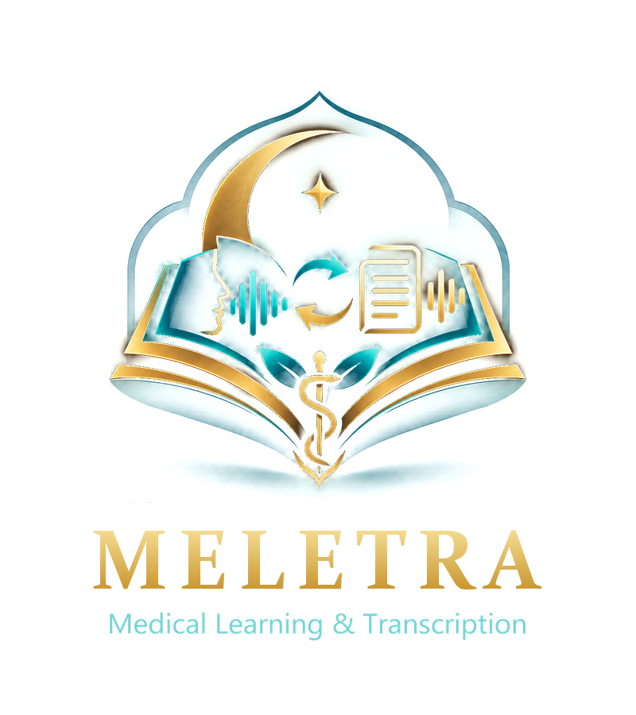

<p align="center"></p>

# MELETRA

**Medical Learning & Transcription.** Offline medical lecture transcription and study assistant (formerly WhisperMedical, before that Medical Lecture Transcriber).
Record a lecture, drop the file in, get an accurate transcript with medical terms checked in context, plus a summary, key concepts, flashcards and questions.
Everything runs on your own computer.

> The address of this repository still says *whispermedical-downloads*: it is not renamed so that every earlier link keeps working. The page and the program say MELETRA.

## Install MELETRA

You need no GitHub account, Python, pip, Git, Homebrew, FFmpeg or any other tool, and nothing to download by hand afterwards (the speech model is part of the installation).
A small installer fetches the program, checks every file's SHA-256 and installs it; if your connection drops, run it again and it continues where it stopped.
Installation needs about 8 GB of free disk space (the download is about 3.6 GB on Windows).

### Windows 10 / 11 (64-bit)

**One click:** open the [download page](https://twonezerotwo-hue.github.io/whispermedical-downloads/) and click **Download MELETRA for Windows**
(direct link: [latest/windows](https://twonezerotwo-hue.github.io/whispermedical-downloads/latest/windows/)), then double-click `MELETRA-Installer-Windows.exe`.
Step by step: [Installation instructions](downloads/install-windows.html).

**One command:** open **PowerShell** (Start menu → type `PowerShell` → Enter), paste this line and press Enter:

```powershell
$f = "$env:TEMP\meletra-install.ps1"; iwr -UseBasicParsing 'https://twonezerotwo-hue.github.io/whispermedical-downloads/install/install-windows.ps1' -OutFile $f; powershell -NoProfile -ExecutionPolicy Bypass -File $f
```

The command downloads a small script ([read it first](install/install-windows.ps1)), which fetches the installer program, refuses to run it unless its SHA-256 equals the
published [release manifest](release-manifest.json), and shows the progress in the window. Windows asks you to approve the installation (administrator permission).

**Upgrading from WhisperMedical or Medical Lecture Transcriber:** install MELETRA over it. The earlier program is replaced; your lectures, transcripts, Study material, archive, settings and models are kept.

### Intel Mac (macOS 12 or newer; not for Apple Silicon M1/M2/M3)

**Currently unavailable.** A MELETRA.app for Intel Macs is offered only after it has been built and tested on a real Intel Mac; no older Mac build is ever offered as MELETRA 4.1. When it is available:

**One click:** open the [download page](https://twonezerotwo-hue.github.io/whispermedical-downloads/) and click **Download MELETRA for Intel Mac**, unzip, then open **MELETRA Installer**
(or double-click `Install MELETRA.command` from the same zip).

**One command:** open **Terminal** (Spotlight → `Terminal` → Enter), paste this line and press Enter:

```bash
curl -fsSL --proto '=https' 'https://twonezerotwo-hue.github.io/whispermedical-downloads/install/install-macos.sh' -o /tmp/meletra-install.sh && bash /tmp/meletra-install.sh
```

The script ([read it first](install/install-macos.sh)) is the same installer engine the installer app uses. It checks that this is an Intel Mac (an Apple Silicon Mac is told so and
nothing is installed), downloads the disk image, verifies every SHA-256, copies *MELETRA.app* into Applications (replacing an installed *WhisperMedical.app* or *Medical Lecture Transcriber.app*),
ejects the image and removes its temporary files.

### When do the buttons and commands work?

A platform is offered only after its release passed an automatic end-to-end test (anonymous download of the exact public files, install, start with the network blocked, transcription) **and** the project
owner confirmed the open-source notices. Until both are true the page says *Not available yet* and the commands above stop with the same message. The current state of each platform is in
[release-manifest.json](release-manifest.json) (`status`: `uploaded` = built and checked but not announced, `ready` = available). An older build in the list is never offered as the current version.

## What is included

- **Whisper Large-v3** speech recognition, installed together with the program: nothing is downloaded the first time you start it.
- Medical terminology correction (Medical Expert v3, on by default) with the public medical knowledge database; *Medical Intelligence v4* is an optional, experimental setting (off by default).
- Study workspace for English lectures: summary, key concepts, flashcards, questions. PDF reading and text recognition (OCR). Audio and video files (WAV, MP3, M4A, AAC, MP4, MOV, ...).
- No cloud service is needed for transcription. Optional cloud AI providers for the study material exist in Settings; they are off unless you add a key.

## System requirements

- **Windows** 10/11 x64 (an NVIDIA GPU speeds things up; it also works on the CPU)  ·  **Mac** macOS 12+ on an **Intel** processor (works on the CPU; not available yet).
- 8 GB RAM or more recommended.

## First launch

Windows may show *"Windows protected your PC"* because the installer is not code-signed yet (**More info → Run anyway**). Details: [Windows help](downloads/install-windows.html).
The Mac app (when available) is not notarized by Apple yet: **right-click the app → Open → Open** the first time. Please do not disable Gatekeeper system-wide. Details: [Intel Mac help](downloads/install-mac-intel.html).

## Uninstall

- **Windows:** Settings → Apps → MELETRA → Uninstall. Your transcripts and downloaded models are kept.
- **Mac:** drag *MELETRA.app* (earlier versions: *WhisperMedical.app* or *Medical Lecture Transcriber.app*) from Applications to the Trash.

## Privacy

Transcription, medical term correction, PDF reading and text recognition run on your computer; your audio, video, PDF files and pictures never leave it.

**Nothing is shared unless you switch it on.** From version 4.1.0 MELETRA can share the text of completed transcripts with MELETRA to help improve transcription quality, but this is **off by default**.
You can turn it on in **Settings → Privacy & Data**, after you have been shown what would be shared, and off again at any time (turning it off also deletes anything still waiting to be sent).
What would be sent: the transcript text, the lecture name, the languages, the program version, a random installation number and the time - never audio, video, PDF files, pictures, file paths,
your user name or any hardware number. Versions before 4.1.0 share nothing.

The installer itself only contacts the official download location of this project (github.com / github.io) to fetch the program.

## For developers

The application source code is in a **private** repository and is not needed to install or use MELETRA. This public repository contains only what is needed to
distribute it: the download page, the release manifest, the installer scripts and installer programs (`install/`, `bootstrap/`), the licence texts and the release automation.
Authorized collaborators find the development setup in the README of the private source repository.

## Licenses

See [licenses/THIRD_PARTY_LICENSES.txt](licenses/THIRD_PARTY_LICENSES.txt) and [licenses/MODEL_LICENSES.txt](licenses/MODEL_LICENSES.txt).
Questions or source-code requests for the open-source components: open an [issue](../../issues).
